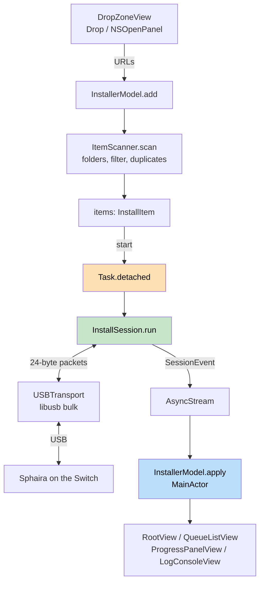

# System Overview

Sphaira Connect is a native macOS app that transfers NSP/XCI/NSZ/XCZ files over USB to the
homebrew app **Sphaira** on a Nintendo Switch — the replacement for the Python script
`usb_install.py`. The code splits into **four layers with a strictly one-way dependency
direction**: `Core/` knows nobody, `USB/` knows `Core/`, `Shared/` knows only SwiftUI, and
`Features/` knows everything and is the only layer on the MainActor. This split is pinned down in
`CONTRACT.md` — not as a recommendation but as a signature contract that every module was built
against individually.

## The four layers

| Folder | May depend on | Isolation | Contents |
|---|---|---|---|
| `Sphaira Connect/Core/` | nothing but `Foundation` | `nonisolated` (exception: `ProgressTracker`, see [[architecture/concurrency-and-cancellation]]) | `CRC32C`, `Packet`, `InstallError`, `InstallItem`/`ItemScanner`, `ByteFormat`, `ProgressTracker`, `RCMPayload`/`RCMTriggerOutcome`, `HekateRelease`/`FuseeRelease` |
| `Sphaira Connect/USB/` | `Core/`, libusb (C) | `@unchecked Sendable`, `nonisolated` | `USBTransport` (the raw bus), `InstallSession` (state machine), `LibUSBProbe`, `RCMTransport` (Fusée Gelée trigger) |
| `Sphaira Connect/Shared/` | SwiftUI/AppKit | MainActor (default) | Design system: `DesignTokens`, `GlassEffectTheme`, `GlassButton`, `GlassInteractive`, `WindowStyleConfigurator`; `AppLogLine`, the log-line type shared by both view models |
| `Sphaira Connect/Features/` | everything below | MainActor | `InstallerModel`/`RCMInjectorModel` (`@Observable`), `HekateDownloader`/`FuseeDownloader`, and `Views/` |

`RootView` switches between two independent, self-contained modes — the Sphaira USB installer
described below, and manual RCM payload injection for unpatched consoles, detailed in
[[protocol/rcm-payload-injection]]. They share the UI shell and the `AppLogLine` type but nothing
at the transport or session level: different USB device (`0x057E`/`0x3000` vs. `0x0955`/`0x7321`),
different model, different monitoring loop.

The dividing line between `Core/` and `USB/` is not cosmetic, it is **driven by testability**:
`SphairaCoreTests/Sources/SphairaCore` is a symlink to `Sphaira Connect/Core`
(`SphairaCore -> ../../Sphaira Connect/Core`). The SwiftPM test package compiles those same files
a second time — without the Xcode project, without a bridging header, without libusb. An
accidental `import SwiftUI` or a `libusb_*` call inside `Core/` therefore breaks the test run
immediately. The layering rule is thus *enforced*, not merely documented; details of the test
setup are in [[operations/testing-strategy]].

## Why `CONTRACT.md` is binding

`CONTRACT.md` lists the **exact signatures** for every module — type names, parameters, orderings,
constants. The reason is division of labour: whoever writes `InstallSession` need not have read
`USBTransport`; whoever builds the views calls `InstallerModel`, which may not even exist yet at
that point. Hence the rule in the contract: if something is missing, add it **additively** (a new
method) without changing what is already there.

The build settings the contract prescribes are actually set that way in the project
(`Sphaira Connect.xcodeproj/project.pbxproj`):

- `MACOSX_DEPLOYMENT_TARGET = 26.5`, `SWIFT_VERSION = 5.0`
- `SWIFT_DEFAULT_ACTOR_ISOLATION = MainActor` — every type is `@MainActor` without doing
  anything, see [[architecture/concurrency-and-cancellation]]
- `ENABLE_APP_SANDBOX = NO` — without a sandbox exemption there is no raw USB access
- `SWIFT_OBJC_BRIDGING_HEADER = Sphaira Connect/USB/SphairaConnect-Bridging-Header.h` —
  this is why the `libusb_*` functions are globally visible without an `import`

How libusb gets statically linked in is described in [[operations/build-configuration]].

On top of that, two rules that are easy to violate while extending the project:

- **The project file is not touched.** The sources hang off a
  `PBXFileSystemSynchronizedRootGroup`; a new file in the right folder is compiled automatically.
  Adding entries to `project.pbxproj` by hand only creates conflicts.
- **No file over 400 lines.** The largest files right now are `InstallerModel.swift` (273) and
  `USBTransport.swift` (270).

## Data flow — from the drop zone to the Switch

The chain in plain words:

1. `DropZoneView` accepts files and folders via `.onDrop` or `NSOpenPanel` and hands raw `URL`s
   to `InstallerModel.add(urls:)`.
2. `ItemScanner.scan` resolves folders recursively, filters for the four installable extensions,
   removes duplicates and sorts stably in alphabetical order —
   see [[architecture/queue-and-file-scanning]].
3. `InstallerModel.start()` freezes the queue into an `InstallSession` and starts it via
   `Task.detached`. The view model is **not** handed to the session.
4. The session speaks the SPH0 protocol ([[protocol/sph0-wire-protocol]]) through `USBTransport`
   ([[usb/libusb-transport]]) and follows the flow described in
   [[protocol/install-session-flow]].
5. All feedback — log lines, device, progress, item states — travels back to the MainActor as
   `SessionEvent` values through **one** `AsyncStream`.
6. `RootView` renders queue, progress and log from that; the phase tint of the window background
   (`Colors.backgroundTint*`) follows `model.phase`.

`Sphaira_ConnectApp.swift` deliberately stays empty apart from `WindowGroup`,
`.windowStyle(.hiddenTitleBar)` and `.windowResizability(.contentSize)`; `ContentView.swift` is a
three-line shell around `RootView`. The window's appearance (transparent title bar, animated
resizing) is handled by `WindowStyleConfigurator` as an `NSViewRepresentable` — the structure of
the views is covered in [[ui/window-and-views]], the design system in
[[ui/design-system-liquid-glass]].

## What the contract does not say (deviations and additions)

The contract reflects the state *before* the build; in three places the implementation
deliberately went beyond it. All three are additive:

- **`Core/ProgressTracker.swift` does not appear in the contract.** The contract prescribed a
  high-water mark, `max(so far, offset + bytes read)`. That failed in the field because for XCI
  files the Switch reads near the end of the file early on — the bar jumped straight to 100 %.
  Replaced by cumulative counting, see [[protocol/progress-tracking]].
- **The error path for a single file does not abort the session.** `transferFile` returns `Bool`
  instead of throwing, so that the Switch's final quit command still gets a regular answer
  ([[protocol/install-session-flow]]).
- **The return channel is an `AsyncStream`,** not a `Task { @MainActor in … }` per callback.
  The rationale is in [[architecture/concurrency-and-cancellation]].
- **RCM payload injection is not in the contract at all.** It was added wholesale in v1.1 as a
  second mode alongside the installer, following the same layering rules but touching a
  completely different USB device and protocol. Full details in
  [[protocol/rcm-payload-injection]].

One piece of legacy is also visible: `USB/LibUSBProbe.swift` claims in its header comment that it
is "used by the status display". In reality no other source file references the type — device
monitoring calls `USBTransport.isSwitchAttached()`, which contains the same logic a second time.
`LibUSBProbe` is therefore pure smoke-test code (it can additionally report the libusb version)
and not part of the data flow.

## Device identification

The Switch is recognised by `idVendor == 0x057E` and `idProduct == 0x3000` — both constants exist
twice in the project (`USBTransport.vendorID/productID` and `LibUSBProbe.vendorID/productID`).
Whoever changes them has to touch both places.
