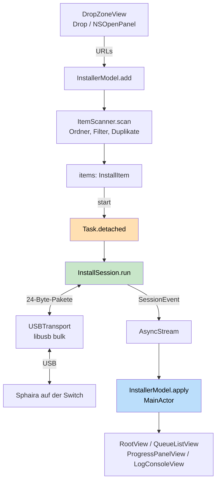

# Systemüberblick

Sphaira Connect ist eine native macOS-App, die NSP/XCI/NSZ/XCZ-Dateien per USB an die
Homebrew-App **Sphaira** auf einer Nintendo Switch überträgt — der Ersatz für das
Python-Skript `usb_install.py`. Der Code zerfällt in **vier Schichten mit strikt
einseitiger Abhängigkeitsrichtung**: `Core/` kennt niemanden, `USB/` kennt `Core/`,
`Shared/` kennt nur SwiftUI, `Features/` kennt alles und ist die einzige Schicht auf dem
MainActor. Verbindlich festgeschrieben ist dieser Schnitt in `CONTRACT.md` — nicht als
Empfehlung, sondern als Signaturvertrag, gegen den jedes Modul einzeln gebaut wurde.

## Die vier Schichten

| Ordner | Darf abhängen von | Isolation | Inhalt |
|---|---|---|---|
| `Sphaira Connect/Core/` | nichts außer `Foundation` | `nonisolated` (Ausnahme: `ProgressTracker`, siehe [[architecture/concurrency-and-cancellation]]) | `CRC32C`, `Packet`, `InstallError`, `InstallItem`/`ItemScanner`, `ByteFormat`, `ProgressTracker` |
| `Sphaira Connect/USB/` | `Core/`, libusb (C) | `@unchecked Sendable`, `nonisolated` | `USBTransport` (roher Bus), `InstallSession` (Zustandsautomat), `LibUSBProbe` |
| `Sphaira Connect/Shared/` | SwiftUI/AppKit | MainActor (Standard) | Designsystem: `DesignTokens`, `GlassEffectTheme`, `GlassButton`, `GlassInteractive`, `WindowStyleConfigurator` |
| `Sphaira Connect/Features/` | alles darunter | MainActor | `InstallerModel` (`@Observable`) und `Views/` |

Die Trennlinie zwischen `Core/` und `USB/` ist keine Kosmetik, sondern **testbarkeitsgetrieben**:
`SphairaCoreTests/Sources/SphairaCore` ist ein Symlink auf `Sphaira Connect/Core`
(`SphairaCore -> ../../Sphaira Connect/Core`). Das SwiftPM-Testpaket kompiliert dieselben
Dateien noch einmal — ohne Xcode-Projekt, ohne Bridging-Header, ohne libusb. Ein
versehentliches `import SwiftUI` oder ein `libusb_*`-Aufruf in `Core/` bricht deshalb sofort
den Testlauf. Die Schichtregel ist damit *erzwungen*, nicht nur dokumentiert; Einzelheiten
zum Testaufbau in [[operations/testing-strategy]].

## Warum `CONTRACT.md` verbindlich ist

`CONTRACT.md` listet für jedes Modul die **exakten Signaturen** — Typnamen, Parameter,
Reihenfolgen, Konstanten. Der Grund ist arbeitsteiliger Bau: Wer `InstallSession` schreibt,
muss `USBTransport` nicht gelesen haben; wer die Ansichten baut, ruft `InstallerModel` auf,
das es zu dem Zeitpunkt vielleicht noch gar nicht gibt. Deshalb die Regel im Vertrag: Wer
etwas vermisst, ergänzt **additiv** (neue Methode), ohne Bestehendes zu ändern.

Die Rahmenbedingungen aus dem Vertrag sind im Projekt tatsächlich so gesetzt
(`Sphaira Connect.xcodeproj/project.pbxproj`):

- `MACOSX_DEPLOYMENT_TARGET = 26.5`, `SWIFT_VERSION = 5.0`
- `SWIFT_DEFAULT_ACTOR_ISOLATION = MainActor` — jeder Typ ist ohne Zutun `@MainActor`,
  siehe [[architecture/concurrency-and-cancellation]]
- `ENABLE_APP_SANDBOX = NO` — ohne Sandbox-Ausnahme kein roher USB-Zugriff
- `SWIFT_OBJC_BRIDGING_HEADER = Sphaira Connect/USB/SphairaConnect-Bridging-Header.h` —
  deshalb sind `libusb_*`-Funktionen ohne `import` global sichtbar

Wie libusb statisch dazugelinkt wird, steht in [[operations/build-configuration]].

Dazu zwei Regeln, die man beim Weiterbauen leicht verletzt:

- **Die Projektdatei wird nicht angefasst.** Die Quellen hängen an einer
  `PBXFileSystemSynchronizedRootGroup`; eine neue Datei im richtigen Ordner wird automatisch
  kompiliert. Manuelles Eintragen in `project.pbxproj` erzeugt nur Konflikte.
- **Keine Datei über 400 Zeilen.** Aktuell sind die größten Dateien `InstallerModel.swift`
  (273) und `USBTransport.swift` (270).

## Datenfluss — von der Ablagefläche bis auf die Switch

Die Kette im Klartext:

1. `DropZoneView` nimmt Dateien und Ordner per `.onDrop` oder `NSOpenPanel` entgegen und
   reicht rohe `URL`s an `InstallerModel.add(urls:)`.
2. `ItemScanner.scan` löst Ordner rekursiv auf, filtert auf die vier installierbaren
   Endungen, entfernt Duplikate und sortiert stabil alphabetisch —
   siehe [[architecture/queue-and-file-scanning]].
3. `InstallerModel.start()` friert die Warteschlange in eine `InstallSession` ein und startet
   sie per `Task.detached`. Das Ansichtsmodell wird der Sitzung **nicht** übergeben.
4. Die Sitzung spricht das SPH0-Protokoll ([[protocol/sph0-wire-protocol]]) über
   `USBTransport` ([[usb/libusb-transport]]) und folgt dem Ablauf aus
   [[protocol/install-session-flow]].
5. Alle Rückmeldungen — Protokollzeilen, Gerät, Fortschritt, Eintragszustände — laufen als
   `SessionEvent` durch **einen** `AsyncStream` zurück auf den MainActor.
6. `RootView` rendert daraus Warteschlange, Fortschritt und Protokoll; die Phasenfarbe des
   Fensterhintergrunds (`Colors.backgroundTint*`) folgt `model.phase`.

`Sphaira_ConnectApp.swift` bleibt dabei bewusst leer bis auf `WindowGroup`,
`.windowStyle(.hiddenTitleBar)` und `.windowResizability(.contentSize)`; `ContentView.swift`
ist eine dreizeilige Hülle um `RootView`. Die Fenstergestalt (transparente Titelleiste,
animierte Größenanpassung) macht `WindowStyleConfigurator` als `NSViewRepresentable` —
Aufbau der Ansichten in [[ui/window-and-views]], das Designsystem in
[[ui/design-system-liquid-glass]].

## Was der Vertrag nicht sagt (Abweichungen und Ergänzungen)

Der Vertrag ist Stand *vor* dem Bau; an drei Stellen ist die Umsetzung bewusst darüber
hinausgegangen. Alle drei sind additiv:

- **`Core/ProgressTracker.swift` kommt im Vertrag nicht vor.** Der Vertrag schrieb eine
  Hochwassermarke `max(bisher, offset + gelesen)` vor. Die hat in freier Wildbahn versagt,
  weil die Switch bei XCI-Dateien früh nahe dem Dateiende liest — der Balken stand sofort
  bei 100 %. Ersetzt durch Summenzählung, siehe [[protocol/progress-tracking]].
- **Der Fehlerpfad einer Datei bricht die Sitzung nicht ab.** `transferFile` liefert `Bool`
  statt zu werfen, damit der abschließende Quit-Befehl der Switch noch regulär beantwortet
  wird ([[protocol/install-session-flow]]).
- **Der Rückkanal ist ein `AsyncStream`,** nicht ein `Task { @MainActor in … }` je Callback.
  Begründung in [[architecture/concurrency-and-cancellation]].

Eine Altlast ist außerdem sichtbar: `USB/LibUSBProbe.swift` behauptet im Kopfkommentar, es
werde „von der Statusanzeige benutzt". Tatsächlich referenziert kein anderer Quelltext den
Typ — die Geräteüberwachung ruft `USBTransport.isSwitchAttached()` auf, das dieselbe Logik
noch einmal enthält. `LibUSBProbe` ist damit reiner Rauchtest-Code (er kann zusätzlich die
libusb-Version melden) und kein Bestandteil des Datenflusses.

## Gerätekennung

Die Switch wird über `idVendor == 0x057E` und `idProduct == 0x3000` erkannt — beide
Konstanten stehen doppelt im Projekt (`USBTransport.vendorID/productID` und
`LibUSBProbe.vendorID/productID`). Wer sie ändert, muss beide Stellen anfassen.
