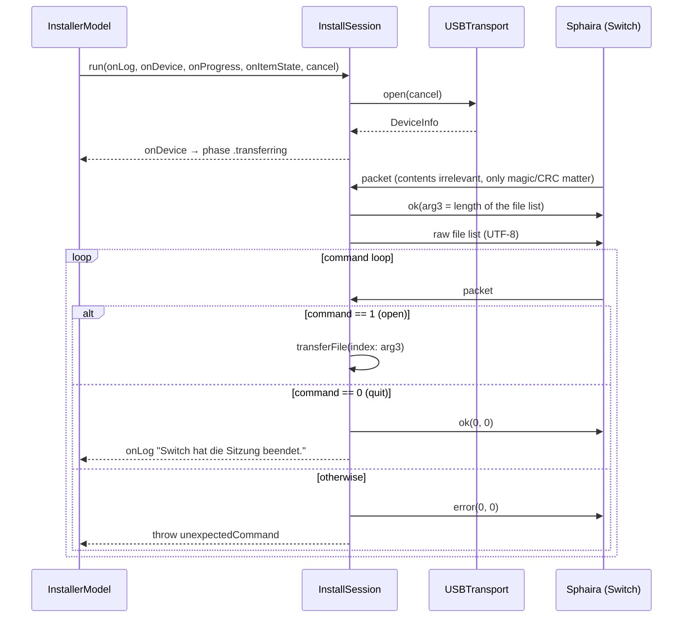

# Install Session Flow

The session flow is **not a suggestion but an order that must not be deviated from**: at every step
the Switch blocks waiting for an answer. A skipped packet, an extra packet or an abruptly closed
bus leaves Sphaira hanging on the console — and then only a restart of the homebrew app helps.
`CONTRACT.md` therefore pins the flow down step by step, and `InstallSession.run` implements
exactly that flow as a flat state machine: **connect → file list → command loop → file loop.**

## The whole picture



## 1. Connect

```swift
defer { transport.close() }
let device = try transport.open(cancel: cancel)
onDevice(device)
```

`open` blocks until a Switch with `0x057E:0x3000` is on the bus (retries every 250 ms), claims
interface 0 and reads the device descriptors ([[usb/libusb-transport]]). The `defer` sits **before**
the first `try` — no matter which path the session ends on, the bus is released.

Note what does *not* happen here: there is no log line "waiting for the Switch". That one is
written by `InstallerModel.start()` before the session even begins; a second `onLog` would only
duplicate it.

## 2. File list

```swift
var tableBytes: [UInt8] = []
for item in items {
    tableBytes.append(contentsOf: Array((item.displayName + "\n").utf8))
}

// The Switch's first packet carries no content — decode checks
// magic and CRC, nothing else matters here.
_ = try transport.readPacket(cancel: cancel)
try transport.send(.ok, arg3: UInt32(tableBytes.count), arg4: 0, cancel: cancel)
try transport.write(tableBytes, cancel: cancel)
```

The format is as plain as it gets: **file name plus `\n`, UTF-8, no header, no escaping of the
separator, no special handling of the last entry.** The last entry ends with `\n` as well. The
length in bytes (not in characters!) is sent ahead in `arg3` of the OK packet so the Switch knows
how much to read in.

Two consequences you have to be aware of:

- **A `\n` inside a file name splits the entry in two.** On APFS that is a legal character. The
  scanner does not filter it out ([[architecture/queue-and-file-scanning]]) — the indices would
  shift and the Switch would request the wrong file.
- **The order of the list *is* the index.** What the Switch later sends as `packet.arg3` of an
  `open` is the position in exactly this list. This is why `items` must not change during the
  session; `InstallerModel` locks `remove`/`clearAll` via `isBusy`.

The first packet read is deliberately discarded. It is the Switch's kick-off ("I am ready");
`decode` still checks magic and CRC, so a wrong peer is exposed immediately
([[protocol/sph0-wire-protocol]]).

## 3. Command loop

```swift
while true {
    let packet = try transport.readPacket(cancel: cancel)

    switch packet.command {
    case SphairaCommand.quit.rawValue:
        try transport.send(.ok, arg3: 0, arg4: 0, cancel: cancel)
        onLog("Switch hat die Sitzung beendet.")
        return

    case SphairaCommand.open.rawValue:
        let index = Int(packet.arg3)
        guard items.indices.contains(index) else {
            try transport.send(.error, arg3: 0, arg4: 0, cancel: cancel)
            throw InstallError.fileUnreadable(path: "#\(index)", reason: "Dateiindex außerhalb der Liste")
        }
        …
    default:
        try transport.send(.error, arg3: 0, arg4: 0, cancel: cancel)
        throw InstallError.unexpectedCommand(packet.command)
    }
}
```

**The Switch drives the session, not the host.** It decides which file is requested when, whether a
file comes twice and when things are over. The host is a pure responder. That is also why there is
no "session complete" detection based on the list: it is done when `quit` arrives.

The index check still sends an error packet before throwing. That is the difference between
"Sphaira shows an error message" and "Sphaira waits forever".

## 4. File transfer

```swift
let file = try FileHandle(forReadingFrom: item.url)
let size = try file.seekToEnd()
…
try transport.sendFileInfo(size: size, flags: TransferFlags.none, cancel: cancel)

while true {
    let packet = try transport.readPacket(cancel: cancel)
    let offset = packet.dataOffset
    let requested = Int(packet.dataSize)

    if offset == 0 && requested == 0 {
        try transport.send(.ok, arg3: 0, arg4: 0, cancel: cancel)
        break
    }

    try file.seek(toOffset: offset)
    // nil means end of file — treat it as an empty answer.
    chunk = [UInt8](try file.read(upToCount: requested) ?? Data())

    try transport.send(.ok, arg3: UInt32(chunk.count), arg4: CRC32C.checksum(chunk), cancel: cancel)
    try transport.write(chunk, cancel: cancel)

    tracker.record(chunkSize: chunk.count)
    emitProgress(force: false)
}
```

Four points that are not obvious:

1. **The reported size comes from `seekToEnd()`, not from `item.byteCount`.** What counts is the
   state of the file at the moment of transfer; `byteCount` from the scan only feeds the overall
   total shown in the UI.
2. **The Switch reads at random, not sequentially.** Every packet brings its own position; the host
   jumps there with `seek(toOffset:)`. Ranges may be requested more than once. Precisely for that
   reason progress cannot be derived from the position — see [[protocol/progress-tracking]].
3. **`offset == 0 && requested == 0` is the end-of-file signal**, not a request for zero bytes at
   position zero. The host acknowledges with `ok(0, 0)` and leaves the file loop.
4. **The order is mandatory: header packet first, then the data.** The OK packet reports the length
   actually read in `arg3` (which near the end of the file may be smaller than `requested`) and the
   CRC32C of the block in `arg4`. The Switch then knows how many bytes are about to arrive and can
   verify them. A `read` that returns `nil` is answered as an empty block — `arg3 = 0`,
   `arg4 = CRC32C([]) = 0` — instead of running into an error.
5. **The completion check allows a small shortfall.** `tracker.sentBytes` must reach `size -
   completionTolerance` (4096 bytes), not exactly `size` — NSP/XCI container padding at the end of
   the last entry is never explicitly requested. Details and the field case that caused this in
   [[operations/troubleshooting]], case 10.

## 5. When a file fails

The most interesting part of the machine. `transferFile` returns `Bool` instead of throwing:

```swift
/// Returns `true` if the file was transferred completely.
///
/// On a file error an error packet goes to the Switch. Sphaira then aborts the
/// whole installation, but still sends the closing respectively quit command —
/// which the command loop answers as usual. That way the session ends in an
/// orderly fashion instead of with an abrupt USB drop.
```

Concretely: if the file cannot be opened, or a `seek`/`read` fails halfway through (volume removed,
permissions withdrawn), it calls `reportFailure`:

```swift
func reportFailure(_ reason: String) throws {
    try transport.send(.error, arg3: 0, arg4: 0, cancel: cancel)
    onItemState(index, .failed(reason))
    onLog("Fehler bei \(item.displayName): \(reason)")
}
```

— and returns `false`. The **command loop keeps running** and answers the `quit` that arrives
afterwards perfectly normally. If `transferFile` threw instead, the `defer { transport.close() }`
would fire immediately, the bus would be pulled out from under the Switch while it is waiting, and
Sphaira would hang. Returning `false` is therefore not a stylistic choice but the difference
between a clean shutdown and a hung one.

The error packet is moreover the same one (`error, 0, 0`) that the command loop sends for unknown
commands — the Switch only has to know a single failure case.

## 6. Bookkeeping and messages

```swift
if transferred {
    completedBytes += items[index].byteCount
}
```

Only files that were **actually transferred** increase `completedBytes`; otherwise the overall
progress would jump over a failed file and end up showing more bytes than ever went over the wire.
The overall progress of a running transfer is accordingly `completedBytes + tracker.clampedSent`.

The state messages are terse:

| Moment | `onItemState` | `onLog` |
|---|---|---|
| File start | `.transferring` | "Übertrage *name* …" |
| File error | `.failed(reason)` | "Fehler bei *name*: *reason*" |
| File end | `.done` | "*name* fertig übertragen." |
| Session end | — | "Switch hat die Sitzung beendet." |

`InstallerModel` tallies `.done` messages in the `DoneCounter` and derives
`.finished(transferred:)` from it — details in [[architecture/concurrency-and-cancellation]].
Before `onItemState(index, .done)` there is a forced `emitProgress(force: true)`, so that the final
display does not fall victim to the 100 ms throttling.

## 7. Cancellation

`cancel` is passed as a closure through **every** transport call and polled inside the timeout
loops. A cancellation throws `InstallError.cancelled` — out of `open`, `read` or `write`, depending
on where the session currently is. The rest follows automatically: `defer` closes the bus,
`InstallerModel` catches `InstallError.cancelled` separately and reports `.cancelled` instead of
`.failed`. Unlike the file-error case, the Switch is told **nothing**: the bus is closed in the
middle of the protocol. On the console you should expect a hung or aborted installation afterwards
— that is the deliberately accepted price for a cancellation that takes effect immediately.
