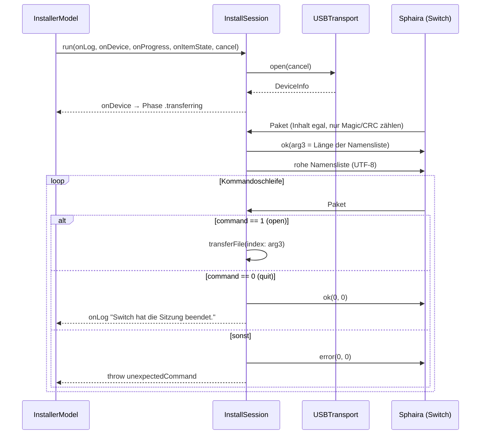

# Ablauf einer Installationssitzung

Der Sitzungsablauf ist **kein Vorschlag, sondern eine Reihenfolge, von der nicht abgewichen
werden darf**: Die Switch wartet an jedem Schritt blockierend auf eine Antwort. Ein
ausgelassenes Paket, ein zusätzliches Paket oder ein abrupt geschlossener Bus lassen Sphaira
auf der Konsole hängen — dann hilft nur noch ein Neustart der Homebrew-App. `CONTRACT.md`
schreibt den Ablauf deshalb Schritt für Schritt fest, und `InstallSession.run` setzt genau
diesen Ablauf als flachen Zustandsautomaten um: **Verbinden → Namensliste → Kommandoschleife
→ Dateischleife.**

## Gesamtbild



## 1. Verbinden

```swift
defer { transport.close() }
let device = try transport.open(cancel: cancel)
onDevice(device)
```

`open` blockiert, bis eine Switch mit `0x057E:0x3000` am Bus hängt (Versuche alle 250 ms),
beansprucht Interface 0 und liest die Gerätebeschreibungen ([[usb/libusb-transport]]). Das `defer` steht **vor** dem
ersten `try` — egal auf welchem Pfad die Sitzung endet, der Bus wird freigegeben.

Bemerkenswert ist, was hier *nicht* passiert: Es gibt keine Protokollzeile „Warte auf die
Switch". Die schreibt `InstallerModel.start()` bereits vor dem Start der Sitzung; ein
zweites `onLog` würde sie nur doppeln.

## 2. Namensliste

```swift
var tableBytes: [UInt8] = []
for item in items {
    tableBytes.append(contentsOf: Array((item.displayName + "\n").utf8))
}

// Das erste Paket der Switch trägt keinen Inhalt — decode prüft
// Magic und CRC, mehr zählt hier nicht.
_ = try transport.readPacket(cancel: cancel)
try transport.send(.ok, arg3: UInt32(tableBytes.count), arg4: 0, cancel: cancel)
try transport.write(tableBytes, cancel: cancel)
```

Das Format ist so schlicht wie möglich: **Dateiname plus `\n`, UTF-8, ohne Kopf, ohne
Trennzeichen-Escaping, ohne abschließende Sonderbehandlung.** Auch der letzte Eintrag endet
mit `\n`. Die Länge in Bytes (nicht in Zeichen!) geht in `arg3` des OK-Pakets voraus, damit
die Switch weiß, wie viel sie einlesen muss.

Zwei Konsequenzen, die man kennen muss:

- **Ein `\n` im Dateinamen zerlegt den Eintrag in zwei.** Auf APFS ist das ein zulässiges
  Zeichen. Der Scanner filtert es nicht ([[architecture/queue-and-file-scanning]]) — die
  Indizes würden verrutschen und die Switch die falsche Datei anfordern.
- **Die Reihenfolge der Liste ist der Index.** Was die Switch später als `packet.arg3` eines
  `open` schickt, ist die Position in genau dieser Liste. Deshalb darf sich `items` während
  der Sitzung nicht ändern; `InstallerModel` sperrt `remove`/`clearAll` über `isBusy`.

Das erste gelesene Paket wird bewusst verworfen. Es ist der Anstoß der Switch („ich bin
bereit"); Magic und CRC prüft `decode` trotzdem, sodass ein falsches Gegenüber sofort
auffliegt ([[protocol/sph0-wire-protocol]]).

## 3. Kommandoschleife

```swift
while true {
    let packet = try transport.readPacket(cancel: cancel)

    switch packet.command {
    case SphairaCommand.quit.rawValue:
        try transport.send(.ok, arg3: 0, arg4: 0, cancel: cancel)
        onLog("Switch hat die Sitzung beendet.")
        return

    case SphairaCommand.open.rawValue:
        let index = Int(packet.arg3)
        guard items.indices.contains(index) else {
            try transport.send(.error, arg3: 0, arg4: 0, cancel: cancel)
            throw InstallError.fileUnreadable(path: "#\(index)", reason: "Dateiindex außerhalb der Liste")
        }
        …
    default:
        try transport.send(.error, arg3: 0, arg4: 0, cancel: cancel)
        throw InstallError.unexpectedCommand(packet.command)
    }
}
```

**Die Switch treibt die Sitzung, nicht der Host.** Sie entscheidet, welche Datei wann
angefordert wird, ob eine Datei doppelt kommt und wann Schluss ist. Der Host ist reiner
Beantworter. Deshalb gibt es auch keine „Sitzung fertig"-Erkennung über die Liste: Fertig ist,
wenn `quit` kommt.

Die Indexprüfung schickt vor dem Werfen noch ein Fehlerpaket. Das ist der Unterschied
zwischen „Sphaira zeigt eine Fehlermeldung" und „Sphaira wartet ewig".

## 4. Dateiübertragung

```swift
let file = try FileHandle(forReadingFrom: item.url)
let size = try file.seekToEnd()
…
try transport.sendFileInfo(size: size, flags: TransferFlags.none, cancel: cancel)

while true {
    let packet = try transport.readPacket(cancel: cancel)
    let offset = packet.dataOffset
    let requested = Int(packet.dataSize)

    if offset == 0 && requested == 0 {
        try transport.send(.ok, arg3: 0, arg4: 0, cancel: cancel)
        break
    }

    try file.seek(toOffset: offset)
    // nil bedeutet Dateiende — als leere Antwort behandeln.
    chunk = [UInt8](try file.read(upToCount: requested) ?? Data())

    try transport.send(.ok, arg3: UInt32(chunk.count), arg4: CRC32C.checksum(chunk), cancel: cancel)
    try transport.write(chunk, cancel: cancel)

    tracker.record(chunkSize: chunk.count)
    emitProgress(force: false)
}
```

Vier Punkte, die nicht offensichtlich sind:

1. **Die gemeldete Größe stammt aus `seekToEnd()`, nicht aus `item.byteCount`.** Maßgeblich
   ist der Zustand der Datei im Moment der Übertragung; `byteCount` aus dem Scan dient nur
   der Gesamtsumme in der Oberfläche.
2. **Die Switch liest wahlfrei, nicht sequenziell.** Jedes Paket bringt eine eigene Position;
   der Host springt per `seek(toOffset:)` dorthin. Bereiche dürfen mehrfach angefordert
   werden. Genau deshalb kann der Fortschritt nicht aus der Position abgeleitet werden —
   siehe [[protocol/progress-tracking]].
3. **`offset == 0 && requested == 0` ist das Ende-Signal**, keine Anforderung von null Bytes
   an Position null. Der Host quittiert mit `ok(0, 0)` und verlässt die Dateischleife.
4. **Reihenfolge ist zwingend: erst das Kopfpaket, dann die Daten.** Das OK-Paket meldet in
   `arg3` die tatsächlich gelesene Länge (die am Dateiende kleiner als `requested` sein kann)
   und in `arg4` die CRC32C des Blocks. Die Switch weiß danach, wie viele Bytes gleich
   kommen, und kann sie prüfen. Ein `read`, das `nil` liefert, wird als leerer Block
   beantwortet — `arg3 = 0`, `arg4 = CRC32C([]) = 0` — statt in einen Fehler zu laufen.

## 5. Wenn eine Datei scheitert

Der interessanteste Teil des Automaten. `transferFile` liefert `Bool` statt zu werfen:

```swift
/// Liefert `true`, wenn die Datei vollständig übertragen wurde.
///
/// Bei einem Dateifehler geht ein Fehlerpaket an die Switch. Sphaira bricht
/// daraufhin die gesamte Installation ab, schickt aber noch den Abschluss-
/// beziehungsweise Quit-Befehl — den beantwortet die Kommandoschleife regulär.
/// So endet die Sitzung geordnet statt mit einem abrupten USB-Abriss.
```

Konkret: Lässt sich die Datei nicht öffnen oder schlägt ein `seek`/`read` mittendrin fehl
(entferntes Volume, entzogene Rechte), ruft `reportFailure` auf:

```swift
func reportFailure(_ reason: String) throws {
    try transport.send(.error, arg3: 0, arg4: 0, cancel: cancel)
    onItemState(index, .failed(reason))
    onLog("Fehler bei \(item.displayName): \(reason)")
}
```

— und kehrt mit `false` zurück. Die **Kommandoschleife läuft weiter** und beantwortet das
danach eintreffende `quit` ganz normal. Würde `transferFile` stattdessen werfen, liefe das
`defer { transport.close() }` sofort los, die Switch bekäme mitten im Warten den Bus unter
den Füßen weggezogen und Sphaira stünde. Die Rückgabe `false` ist also kein Stilmittel,
sondern der Unterschied zwischen einem sauberen und einem hängenden Abbruch.

Das Fehlerpaket ist außerdem dasselbe (`error, 0, 0`), das die Kommandoschleife bei
unbekannten Kommandos schickt — die Switch braucht nur einen Fehlerfall zu kennen.

## 6. Buchführung und Meldungen

```swift
if transferred {
    completedBytes += items[index].byteCount
}
```

Nur **tatsächlich übertragene** Dateien erhöhen `completedBytes`; sonst spränge der
Gesamtfortschritt über eine gescheiterte Datei hinweg und zeigte am Ende mehr Bytes an, als je
über den Bus gingen. Der Gesamtfortschritt eines laufenden Transfers ist entsprechend
`completedBytes + tracker.clampedSent`.

Die Zustandsmeldungen sind knapp:

| Zeitpunkt | `onItemState` | `onLog` |
|---|---|---|
| Dateibeginn | `.transferring` | „Übertrage *Name* …" |
| Dateifehler | `.failed(Grund)` | „Fehler bei *Name*: *Grund*" |
| Dateiende | `.done` | „*Name* fertig übertragen." |
| Sitzungsende | — | „Switch hat die Sitzung beendet." |

`InstallerModel` zählt `.done`-Meldungen im `DoneCounter` mit und meldet daraus
`.finished(transferred:)` — Einzelheiten in [[architecture/concurrency-and-cancellation]].
Vor `onItemState(index, .done)` steht ein erzwungenes `emitProgress(force: true)`, damit die
letzte Anzeige nicht der 100-ms-Drosselung zum Opfer fällt.

## 7. Abbruch

`cancel` wird als Closure durch **jeden** Transportaufruf gereicht und in den Timeout-Schleifen
abgefragt. Ein Abbruch wirft `InstallError.cancelled` — aus `open`, `read` oder `write`, je
nachdem wo die Sitzung gerade steht. Der Rest folgt automatisch: `defer` schließt den Bus,
`InstallerModel` fängt `InstallError.cancelled` gesondert und meldet `.cancelled` statt
`.failed`. Anders als beim Dateifehler wird der Switch dabei **nichts** mitgeteilt: Der Bus
wird mitten im Protokoll geschlossen. Auf der Konsole ist danach mit einer hängenden oder
abgebrochenen Installation zu rechnen — das ist der bewusst in Kauf genommene Preis dafür,
dass ein Abbruch sofort greift.
